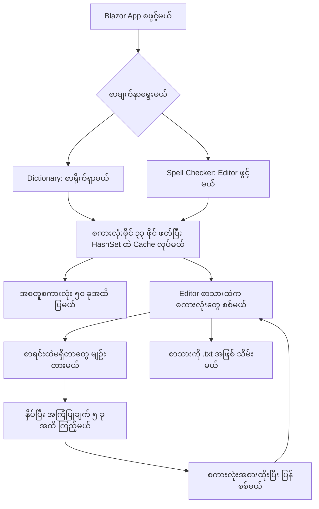

# Word List (မြန်မာစကားလုံးများ)

မြန်မာစကားလုံးတွေကို ရှာဖွေနိုင်ပြီး စာလုံးပေါင်းစစ်ကြည့်နိုင်တဲ့ Blazor WebAssembly Project ပါ။ [Burma Project Ideas](https://github.com/burma-project-ideas) အောက်မှာ နောက်လာမယ့်သူတွေ လေ့လာနိုင်ဖို့၊ ကိုယ်နှစ်သက်တဲ့ Programming Language နဲ့ ပြန်ရေးကြည့်နိုင်ဖို့ ထားပေးထားတာပါ။

## အဓိက ပံ့ပိုးသူများနှင့် မူရင်း Data

| ပံ့ပိုးသူ | ပံ့ပိုးထားသည့်အပိုင်း |
| --- | --- |
| [Kanaung Wordlists နှင့် မူရင်းပံ့ပိုးသူများ](https://github.com/kanaung/wordlists) | ဒီ Project မှာ အသုံးပြုထားတဲ့ မြန်မာစကားလုံးစာရင်းများ၏ မူရင်းရင်းမြစ် |
| [Sann Lynn Htun (@sannlynnhtun-coding)](https://github.com/sannlynnhtun-coding) | Blazor WebAssembly App၊ Dictionary Search၊ Spell Checker နဲ့ UI ရေးသားမှု |

မူရင်း [Kanaung README](https://github.com/kanaung/wordlists#readme) အရ စကားလုံးတွေကို ၂၀၀၃ ခုနှစ်ထုတ် မြန်မာစာလုံးပေါင်းသတ်ပုံကျမ်းကနေ ထုတ်ယူပြီး ပြင်ဆင်ထားတာပါ။ Data ပြန်သုံးတဲ့အခါ မူရင်းရင်းမြစ်ကို Credit ပေးပြီး [မူရင်း License](https://github.com/kanaung/wordlists/blob/master/LICENSE) ကိုလည်း ဖတ်ပါ။

## အသုံးပြုပုံ

- **Dictionary (`/`)** — မြန်မာစကားလုံးရဲ့ အစစာလုံးတွေကို ရိုက်ထည့်ပြီး ကိုက်ညီတဲ့ စကားလုံးတွေကို ရှာနိုင်ပါတယ်။ အဓိပ္ပာယ်ဖွင့်ဆိုချက်တွေ မပါပါဘူး။
- **Spell Checker (`/spell-check`)** — စာရိုက်ထည့်ပြီး စာရင်းထဲမှာ မရှိတဲ့ စကားလုံးတွေကို အနီရောင်မျဉ်းနဲ့ ပြပေးပါတယ်။ မျဉ်းတားထားတဲ့ စကားလုံးကို နှိပ်ပြီး အကြံပြုချက်ရွေးနိုင်သလို **Save .txt** နဲ့ စာသားကို သိမ်းနိုင်ပါတယ်။
- Light/Dark Theme ပြောင်းနိုင်ပါတယ်။ Search နဲ့ Spell Check ကို Browser ထဲမှာပဲ လုပ်ဆောင်ပြီး စာသားကို စစ်ပေးမယ့် Server API ဆီ မပို့ပါဘူး။ App နဲ့ Data ဖိုင်တွေကိုတော့ Hosting ကနေ Download လုပ်ရပါတယ်။

## App ရဲ့ Workflow

### ၁။ App နဲ့ Service တွေ စတင်မယ်

`BlazorWordList/Program.cs` က Blazor WebAssembly ကို စတင်ပြီး `DictionaryLoaderService` နဲ့ `SpellCheckService` ကို Register လုပ်ပါတယ်။ `Pages/Home.razor` က Dictionary UI ကို ပြပြီး `Pages/SpellCheck.razor` က Spell Checker UI ကို ပြပါတယ်။

### ၂။ စကားလုံးစာရင်းတွေ ဖတ်မယ်

`DictionaryLoaderService.LoadAllWordsAsync()` က `wwwroot/data/` ထဲက `က.list` ကနေ `အ.list` အထိ သတ်မှတ်ထားတဲ့ ဖိုင် ၃၃ ဖိုင်ကို HTTP နဲ့ အစဉ်လိုက် ဖတ်ပါတယ်။ တစ်ကြောင်းစီကို Trim လုပ်ပြီး အလွတ်စာကြောင်းတွေ ဖယ်ကာ `HashSet<string>` ထဲ ထည့်တဲ့အတွက် တူညီတဲ့စကားလုံးတွေ တစ်ခုပဲ ကျန်ပါတယ်။

ဖတ်ပြီးသားစာရင်းကို Service ရဲ့ Memory ထဲမှာ Cache လုပ်ထားပါတယ်။ ဖိုင်တစ်ခု ဖတ်မရရင် Console မှာ Error ရေးပြီး ကျန်ဖိုင်တွေကို ဆက်ဖတ်ပါတယ်။ အဲ့ဒီအခါ စကားလုံးစာရင်း မပြည့်စုံနိုင်ပါဘူး။

### ၃။ Dictionary မှာ ရှာမယ်

`DictionaryArea.razor` က ရိုက်ထည့်ထားတဲ့စာသားကို `SearchWordsAsync()` ဆီ ပို့ပါတယ်။ Query နဲ့ **အစတူတဲ့** စကားလုံးတွေကို `StartsWith` နဲ့ ရှာပြီး စကားလုံးအရှည်၊ ပြီးတော့ စကားလုံးအစဉ်အလိုက် စီကာ အများဆုံး **၅၀ ခု** ပြပါတယ်။ စာသားအလွတ်ဖြစ်ရင် ရလဒ်တွေကို ရှင်းပါတယ်။ ရလဒ်ထဲက စကားလုံးကို နှိပ်ရင် အဲ့ဒီစကားလုံးနဲ့ ပြန်ရှာပါတယ်။

### ၄။ စာလုံးပေါင်းစစ်မယ်

`SpellCheckArea.razor` က စကားလုံးစာရင်းကို ဖတ်ပြီး `SpellCheckService.Initialize()` နဲ့ အသင့်ပြင်ပါတယ်။ စာရိုက်ပြီး **၅၀၀ milliseconds** ခန့် ရပ်တဲ့အခါ Space၊ Line Break နဲ့ သတ်မှတ်ထားတဲ့ Punctuation တွေအလိုက် စာသားကို ခွဲပါတယ်။

`IsWordCorrect()` က ASCII စာလုံးတွေနဲ့ပဲ ဖွဲ့ထားတဲ့စာသားကို ကျော်ပြီး ကျန်စကားလုံးတွေ `HashSet` ထဲမှာ ရှိမရှိ စစ်ပါတယ်။ မရှိတဲ့စကားလုံးတွေကို `wwwroot/js/spellchecker.js` က Editor ထဲမှာ မျဉ်းတားပြပါတယ်။

### ၅။ အကြံပြုချက်ရွေးပြီး စာသားသိမ်းမယ်

မျဉ်းတားထားတဲ့ စကားလုံးကို နှိပ်ရင် `GetSuggestions()` က စကားလုံးစာရင်းနဲ့ Levenshtein Distance တွက်ပါတယ်။ Distance **၂ ထက်မပိုတဲ့** စကားလုံးတွေကို Distance၊ စကားလုံးအရှည်အလိုက် စီပြီး အများဆုံး **၅ ခု** ပြပါတယ်။ ရွေးထားတဲ့အကြံပြုချက်နဲ့ စကားလုံးကို အစားထိုးပြီး ပြန်စစ်ပါတယ်။ **Save .txt** က လက်ရှိစာသားကို `corrected_text.txt` အဖြစ် Download လုပ်ပေးပါတယ်။



## Data ကို ယူသုံးချင်ရင်

[BlazorWordList/wwwroot/data](BlazorWordList/wwwroot/data) ထဲမှာ စကားလုံးဖိုင်တွေ ရှိပါတယ်။ UTF-8 နဲ့ ဖတ်ပြီး တစ်ကြောင်းကို စကားလုံးတစ်ခုအဖြစ် ယူသုံးနိုင်ပါတယ်။ `wordlists.list` နဲ့ `nrclist.list` လည်း ပါပေမယ့် လက်ရှိ Loader က ဖိုင် ၃၃ ဖိုင်ကိုပဲ အသုံးပြုပါတယ်။

စလေ့လာမယ်ဆိုရင် `.list` ဖိုင်တစ်ခုကို အရင်ဖတ်ပြီး Prefix Search ရေးကြည့်ပါ။ ပြီးမှ ဖိုင်အားလုံးပေါင်းခြင်း၊ Duplicate ဖယ်ခြင်းနဲ့ စာလုံးပေါင်းအကြံပြုခြင်းတို့ကို ဆက်လေ့လာနိုင်ပါတယ်။ Data ကို Web၊ Mobile၊ Desktop App တွေမှာလည်း မူရင်း Credit နဲ့ License ကို ထိန်းသိမ်းပြီး ယူသုံးနိုင်ပါတယ်။

## Project ဖွဲ့စည်းပုံ

| နေရာ | တာဝန် |
| --- | --- |
| `BlazorWordList/Pages/` | Dictionary နဲ့ Spell Checker Routes |
| `BlazorWordList/Features/Dictionary/` | Search UI |
| `BlazorWordList/Features/DictionaryLoader/` | Data ဖတ်ခြင်း၊ Cache နဲ့ Prefix Search |
| `BlazorWordList/Features/SpellCheck/` | စာလုံးပေါင်းစစ်ခြင်း၊ Suggestion နဲ့ Editor UI |
| `BlazorWordList/wwwroot/data/` | မြန်မာစကားလုံးစာရင်းများ |
| `BlazorWordList/wwwroot/js/` | Editor Highlight၊ စကားလုံးအစားထိုးခြင်း၊ Download နဲ့ Theme |
| `.github/workflows/deploy.yml` | Build နဲ့ Vercel Deployment Workflow |

## Local မှာ Run မယ်

**.NET 10 SDK** နဲ့ **Node.js/npm** လိုပါတယ်။ UI ကို Tailwind CSS v4 နဲ့ ရေးထားပါတယ်။

```bash
git clone https://github.com/burma-project-ideas/word-list.git
cd word-list/BlazorWordList
npm ci
npm run build:css
dotnet watch
```

Terminal မှာ ပြထားတဲ့ Local URL ကို Browser နဲ့ ဖွင့်ပါ။ Release ထုတ်ချင်ရင် Project Directory ထဲမှာ ဒီ Command ကို သုံးနိုင်ပါတယ်။

```bash
dotnet publish -c Release -o ../release
```

Static Hosting အတွက် Output က `release/wwwroot` ဖြစ်ပါတယ်။ `/spell-check` ကို တိုက်ရိုက်ဖွင့်လို့ရအောင် Hosting မှာ SPA Fallback ကို `index.html` ဆီ ပြန်ပို့ပေးဖို့ လိုပါတယ်။ Vercel Workflow သုံးမယ်ဆိုရင် `VERCEL_TOKEN`၊ `VERCEL_ORG_ID` နဲ့ `VERCEL_PROJECT_ID` Repository Secrets လိုပါတယ်။

## လက်ရှိ ကန့်သတ်ချက်များ

- ဒါက စကားလုံးစာရင်းအခြေခံ Checker ဖြစ်ပြီး Grammar Checker သို့မဟုတ် AI Model မဟုတ်ပါဘူး။ စာရင်းထဲမှာ မပါတဲ့ မှန်ကန်တဲ့စကားလုံးကိုလည်း အမှားအဖြစ် ပြနိုင်ပါတယ်။
- Space နဲ့ Punctuation တွေအလိုက်ပဲ စကားလုံးခွဲထားတာကြောင့် Space မခြားတဲ့ မြန်မာဝါကျတွေကို စကားလုံးတစ်လုံးချင်း တိတိကျကျ မခွဲနိုင်ပါဘူး။
- Published Service Worker က `.list` ဖိုင်တွေကို Precache မလုပ်သေးလို့ အင်တာနက်မရှိဘဲ Fresh Load လုပ်တဲ့အခါ Dictionary Data ရမယ်လို့ အာမမခံနိုင်ပါဘူး။ လက်ရှိဖွင့်ထားတဲ့ App မှာ ဖတ်ပြီးသား Data ကတော့ Memory ထဲမှာ ရှိပါတယ်။
